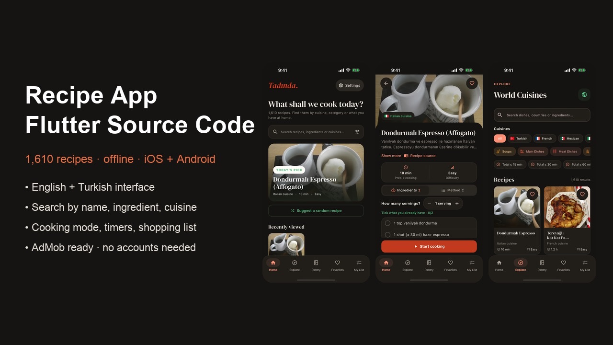
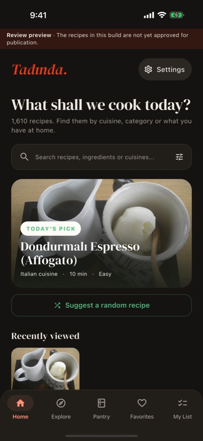
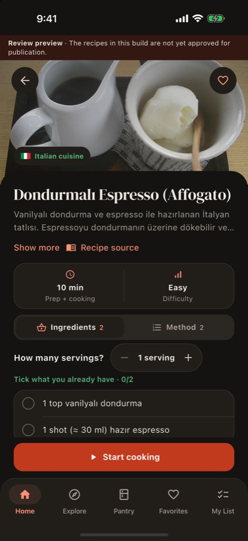
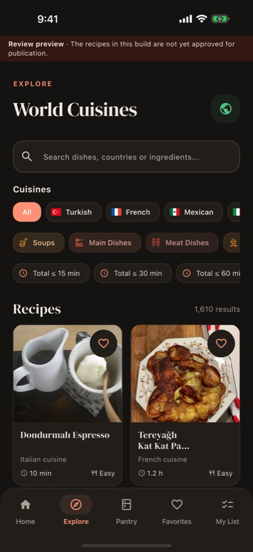
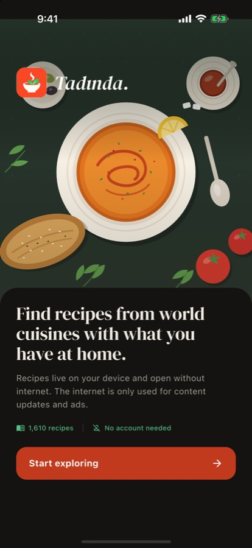

# Flutter Recipe App Source Code – Offline, 1,610 Recipes, iOS & Android

**Tadında** is an offline recipe app for iOS and Android built with Flutter, with the content already done: 1,610 recipes in an SQLite database and an English and Turkish interface.

**Get the source code:** [Gumroad – Recipe App Flutter source code](https://safakavci.gumroad.com/l/flutter-recipe-app-source)

> **This repository is a showcase only.** It contains no source code. The full source code is sold under a commercial license; the links above take you to the store page with the license terms, a demo video and the full feature list.

  
  
  
  

## Features

- 1,610 recipes from Turkish and world cuisines with ingredients, steps, times, servings and difficulty
- Search by name, ingredient or cuisine, with filters
- Ingredient finder: recipes from what you have at home
- Favourites, shopping list, serving calculator
- Step-by-step cooking mode with timers
- English and Turkish interface (more languages on request), light and dark themes
- AdMob with Google's consent (UMP) flow
- Optional over-the-air content updates
- Works fully offline; runs with no accounts

## Tech stack

Flutter · Dart · SQLite · AdMob

## More source code from the same developer

- [Flutter puzzle game source code](https://github.com/safakavciis123-netizen/flutter-puzzle-game-source-code): match-and-pop game, 2000 levels, level editor
- [Islamic prayer & Quran app source code](https://github.com/safakavciis123-netizen/islamic-prayer-quran-app-source-code): native iOS, Apple Watch, Android, Wear OS
- [SwiftUI currency converter & VAT calculator](https://github.com/safakavciis123-netizen/swiftui-currency-converter-vat-calculator)

**Keywords:** flutter recipe app source code, recipe app template, food app flutter, offline recipe app, cooking app source code, flutter app template ios android
